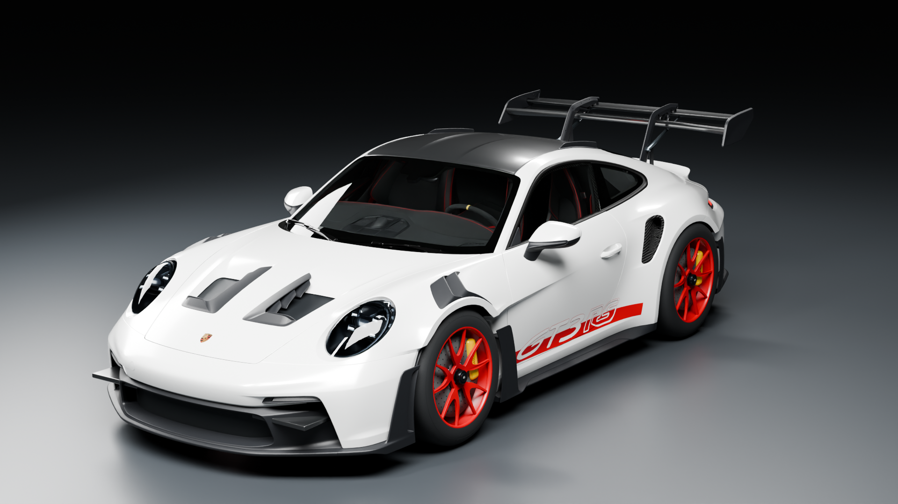
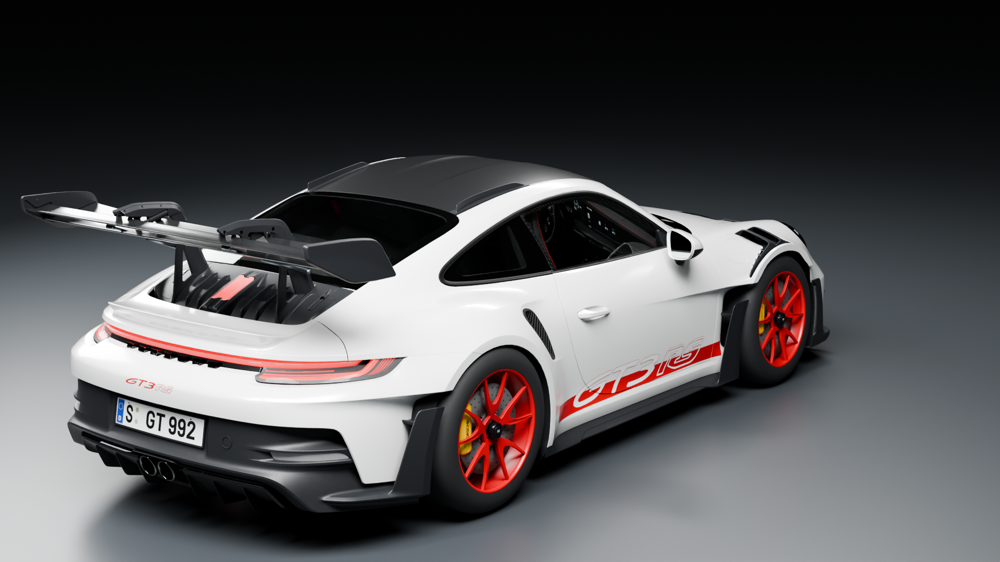
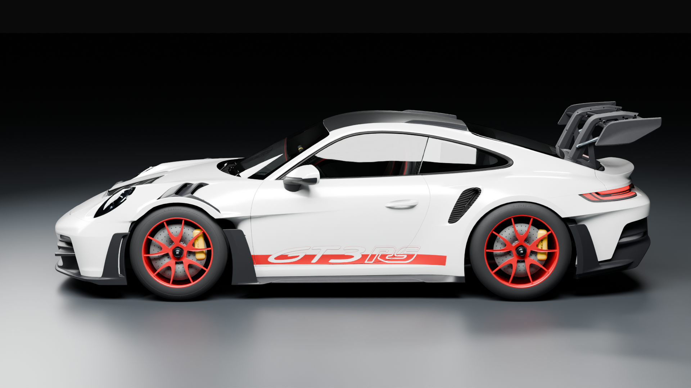
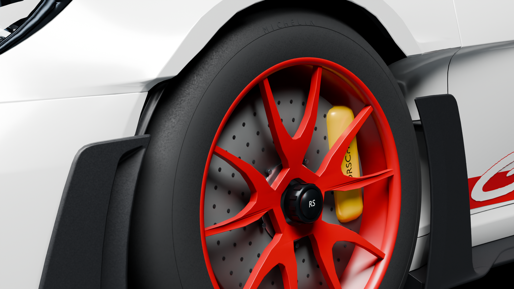

# Porsche model files and studio review

The white/red 992 GT3 RS is available as a playable native-game integration,
an editable Blender source, and three standard textured glTF exports.

| Deliverable | Location |
|---|---|
| Editable source with 52 packed used images | `assets/porsche/Porsche_911_GT3RS_Source.blend` |
| Textured Hero / Near / Far exports | `assets/porsche/portable/exports/` |
| Level hashes and material signatures | `assets/porsche/portable/exports/gt3rs-lods.json` |
| Packaged Windows game | `dist/Breakwater_Windows_x64.exe`, launched by `Play-Game.cmd` |
| Native controllers | `src/breakwater/porsche_rig.cpp`, `porsche_suspension.cpp`, `porsche_native.cpp` |

The portable exports are byte-identical to the validated source exports. They
retain the articulation hierarchy, original artwork UVs, metric detail UVs,
material extensions, embedded images and spring morphs. An independent checker
compares every source/native triangle corner, attribute, morph and image.

The rig controls doors, windows, steering and wheel rotation, front/rear
suspension linkages, springs and dampers, aero/DRS actuators, pedals, paddles,
tachometer, stopwatch hands and mirror adjustment. The game also supplies live
instrument displays and reflected scene mirrors. See
[controls and native validation](PORSCHE_STEERING_MARKER.md).

The following studio images render the actual textured Hero GLB in Blender
Cycles. They use neutral white area lights and recorded cameras. They are
separate from the native-game captures in `screenshots/porsche-native-*`.









`porsche-portable-delivery.json` binds these images and all portable files to
their hashes. `porsche-studio/authoring-render-report.json` records the actual
asset hash, 695,220 triangles, 64-sample render settings, camera positions and
light positions/powers. `scripts/render_porsche_studio.py` reproduces these
views from the repository files with Blender, for example:

```text
blender --background --threads 1 --python scripts/render_porsche_studio.py -- front
```

To play, run `Play-Game.cmd`, start a mission, walk to the white/red Porsche and
press E. WASD drives, Space brakes, C changes camera, O/K open doors when stopped,
I operates windows, and G operates DRS.

The current hidden native checks pass. Local frame-time results and their
instrumentation limits are recorded separately; the studio images do not
establish game frame rate or a cross-device performance guarantee.

`porsche-model-delivery-review.json` records the current executable, code,
asset and capture hashes, 155 passing native checks and eight instrumented
performance cases. Earlier feature reviews describe their historical builds.
The only runtime-code change in this delivery splits normal/depth timing
from color timing; it does not alter model geometry or render submission.

The repository render command was executed for the front view. Its reproduced
image differs from the delivered front image by at most one 8-bit channel
code; see `porsche-studio/reproduction-check.json`. The rear, side and wheel
images were rendered by the recorded authoring script against the same GLB.
